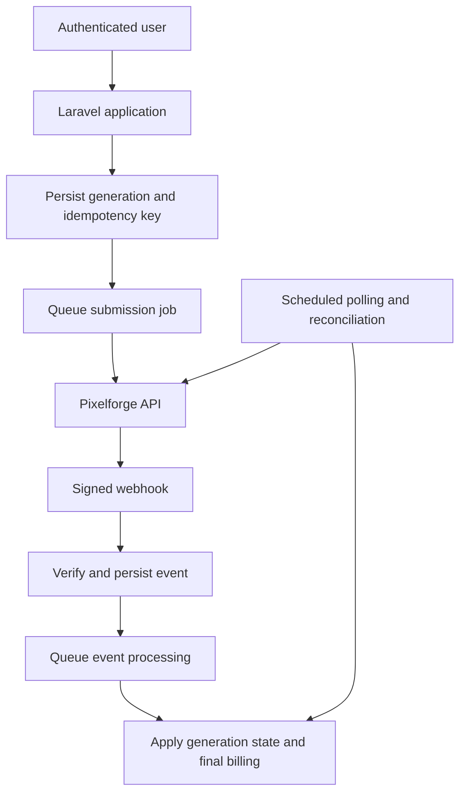

# Pixelforge Image Generation

**A full-stack AI image generation application built around reliable asynchronous processing, exact usage-based billing, and recoverable third-party API integrations.**

Built with **Laravel 13, Vue 3, Inertia, TypeScript, PostgreSQL, and Docker**, the application provides a public introduction and an authenticated, per-user generation studio. It integrates with the [Pixelforge API](https://pixelforge.promptedit.dev/docs) to submit image generation requests, track their lifecycle, process signed webhooks, and reconcile provider usage against local records.

> **Project focus:** This repository demonstrates backend and full-stack engineering decisions for an AI-powered application, especially idempotency, asynchronous workflows, failure recovery, billing precision, and automated testing.

## What the application does

- **Authenticated generation studio:** Keeps generation requests and results associated with their users.
- **Asynchronous provider integration:** Queues image generation submissions instead of blocking web requests.
- **Reliable request tracking:** Persists a local generation ID and immutable idempotency key before contacting the provider.
- **Webhook-driven updates:** Verifies signed provider callbacks, records incoming events, and processes them asynchronously.
- **Recovery and reconciliation:** Polls stale generation states and reconciles daily provider usage with locally recorded results.
- **Exact cost accounting:** Calculates token-based estimates and final charges without floating-point money errors.
- **Automated quality checks:** Exercises API contracts, failure scenarios, event ordering, state transitions, and billing rules.

## Engineering highlights

| Concern | Implementation decision |
| --- | --- |
| **API reliability** | Persist first, submit with an immutable idempotency key, and distinguish unknown submission outcomes from confirmed failures. |
| **Background processing** | Database-backed Laravel queues, bounded retries, and a scheduler for recovery work. |
| **Webhook security** | HMAC-SHA256 signature validation over the timestamp and raw request body, with a five-minute timestamp tolerance. |
| **Duplicate and out-of-order events** | Unique provider event IDs, persisted receipts, transactions, and row-level locks protect generation state. |
| **Billing accuracy** | Integer picodollars (12 decimal places), exact provider rate strings, and a 25% customer markup. |
| **Operational reconciliation** | Compare provider usage and costs with successful local generations by UTC completion day; fail visibly on discrepancies. |
| **Test coverage** | PHPUnit integration tests, Laravel HTTP fakes, static analysis, frontend checks, and CI against SQLite and PostgreSQL. |

## System architecture

The application follows Laravel conventions with a focused service/action layer. Controllers handle HTTP concerns, actions coordinate business workflows, jobs perform background work, and a dedicated API client isolates Pixelforge-specific behavior.



### Key implementation files

| Component | Responsibility |
| --- | --- |
| `app/Support/Money.php` | Immutable, exact USD arithmetic |
| `app/Services/PricingService.php` | Token-based estimates, provider costs, and 25% markup |
| `app/Services/PixelforgeClient.php` | API authentication, pricing lookup, generation creation, and provider error classification |
| `app/Actions/PersistGeneration.php` | Store user ownership, request parameters, estimate, and idempotency key |
| `app/Actions/SubmitGeneration.php` | Obtain pricing and dispatch generation submission |
| `app/Jobs/SubmitPixelforgeGeneration.php` | Execute queued provider requests with bounded retries |
| `app/Actions/RecordPixelforgeAcknowledgement.php` | Attach provider identity and rates without regressing generation state |
| `app/Models/Generation.php` | Generation state, costs, usage, and provider metadata |
| `app/Http/Controllers/PixelforgeWebhookController.php` | Verify raw-body HMAC signature and persist event receipt |
| `app/Jobs/ProcessPixelforgeWebhook.php` | Deduplicate processing and lock generation updates |
| `app/Actions/ApplyPixelforgeGeneration.php` | Shared webhook/polling transition and exact final billing policy |
| `app/Console/Commands/ReconcilePixelforgeGenerations.php` | Retry unprocessed events and poll stale provider states |
| `app/Services/UsageReconciliationService.php` | Reconcile provider usage and exact charges by UTC completion day |
| `app/Console/Commands/ReconcilePixelforgeUsage.php` | CLI date-range validation and discrepancy reporting |

## Important design decisions

**Exact pricing.** Money is represented as integer picodollars rather than PHP floating-point values. Token costs use exact rate strings. Estimates follow provider pricing rules, while final charges use the usage and rates associated with each completed generation. The application preserves precision in storage instead of rounding early to cents.

**Persist before submission.** A local UUID and immutable idempotency key are created before any outbound generation request. The UUID is sent as `metadata.order_id`. Retries reuse the same key and parameters so a timeout does not silently create a second billable generation.

**Explicit failure semantics.** Validation and policy rejections are separate from provider failures. Rate limits and overloads use bounded retries and `Retry-After` where available. An indeterminate outcome remains `submission_unknown` rather than being misclassified as a confirmed failure.

**Safe state transitions.** Webhook events are verified and stored before a prompt 2xx response. Queued processing uses transactions and row locks to avoid duplicate finalization and terminal-state regression. Scheduled polling shares the transition and pricing logic as a recovery path if webhooks are missed.

**Reconciliation.** The `pixelforge:usage-reconcile` command compares the provider's per-key UTC daily usage against locally successful generations, including four token categories, provider costs, and the 25% markup. Mismatches cause a nonzero exit rather than being ignored.

**Pragmatic abstractions.** Eloquent is used directly for persistence; a generic repository layer is intentionally avoided where it would add indirection without improving the workflows.

## Technology stack

| Layer | Technology |
| --- | --- |
| Backend | PHP 8.3+, Laravel 13 |
| Frontend | Vue 3, Inertia, TypeScript, Tailwind CSS |
| Database | PostgreSQL |
| Background processing | Laravel database queues and scheduler |
| Local environment | Docker Compose |
| Testing and CI | PHPUnit, HTTP fakes, formatting, static analysis, frontend checks, SQLite and PostgreSQL 17 |

## Run locally with Docker Compose

**Prerequisites:** Docker Desktop (with Linux containers enabled), Git, and Docker Compose. You do not need host PHP, Composer, Node.js, PostgreSQL, or Laravel Sail installations.

```bash
git clone https://github.com/josiahking/promptedit_ai_image_generation.git
cd promptedit_ai_image_generation
cp .env.docker.example .env

docker compose build app
docker compose up -d db
docker compose run --rm --no-deps app composer install --no-interaction
docker compose run --rm --no-deps app npm install
docker compose run --rm --no-deps app php artisan key:generate
docker compose up -d app
docker compose exec -T app php artisan migrate --force
docker compose up -d frontend worker scheduler
docker compose ps
```

Open **http://localhost:8000**. Docker Compose starts the PHP application, Vite, PostgreSQL, queue worker, and scheduler using the project-owned development image.

Keep provider API keys and webhook signing secrets in your **local** `.env`; never commit them. Deployment environments require their own database and secret configuration.

For Windows Git Bash setup, PostgreSQL test isolation, troubleshooting, and live webhook configuration, see [Local development and testing](docs/LOCAL-DEVELOPMENT.md).

## Testing and verification

Use the isolated test settings in [the daily development workflow](docs/LOCAL-DEVELOPMENT.md#daily-workflow) when running:

```bash
php artisan test
composer ci:check
```

CI covers PHP formatting, static analysis, frontend checks, and PHPUnit. Integration tests use Laravel HTTP fakes to exercise provider contracts, idempotency, timeouts, overloads, acknowledgement races, webhook signatures, duplicate and out-of-order events, exact final charges, polling recovery, and persisted state. CI runs with SQLite in memory and PostgreSQL 17; local Sail uses PostgreSQL.

## API reference

- [Pixelforge API documentation](https://pixelforge.promptedit.dev/docs)
- [Local development and testing](docs/LOCAL-DEVELOPMENT.md)
